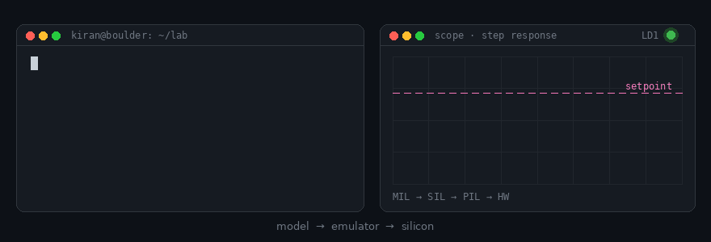

<!-- ✏️ Before publishing: replace every [BRACKETED] placeholder, then delete this comment. -->

# Hi, I'm Kiran 👋

**Firmware Engineer @ Eaton** · Boulder, Colorado 🏔️

I build and verify real-time control and communication firmware: from model, to emulator, to silicon.

`while (1) { build(); verify(); ship(); }`

---

## 🙋 About me

By day I write firmware for Smart Circuit Breakers at Eaton. By night I'm usually at my bench, building things like a drum kit on an ESP32, or putting a blinky LED through four levels of verification, because *"it works on my board"* never felt like enough.

My path so far: vehicle motion control at **ZF**, emissions control software at **KPIT**, an M.S. at **CU Boulder** (with firmware internships at Danfoss, Canoo, and the SWARM-EX CubeSat), and now **Eaton**.

> If it isn't verified, it isn't done.

  

---

## 🧭 How I engineer

- **Requirements first.** Tests are named after requirements and traced back to them. *(see [STM32H7 Control Lab](https://github.com/kiranj26/STM32H7-Nucleo-With-Renode-and-Openmodelica))*
- **Verify at every level.** The same code runs in a model, in an emulator, and on real hardware: MIL → SIL → PIL → HW.
- **Measure, don't guess.** Latency, timing, and sensor data are measured on the bench, not assumed. *(see [Drum Kit](https://github.com/kiranj26/Electronic_Drum_Using_ESP32) and [Posture Tracker](https://github.com/kiranj26/Posture-Tracker-Using-ESP32))*

---

## 🔧 Featured work

**[STM32H7 Control Lab](https://github.com/kiranj26/STM32H7-Nucleo-With-Renode-and-Openmodelica)**: *closed-loop control, verified from model to silicon*
I was tired of tuning gains by trial and error. This is a 7-project curriculum where OpenModelica plant models drive firmware running unmodified in Renode and on a real Nucleo-H743ZI2, with Robot Framework checking every result against written requirements.
**Proof:** a single firmware binary passes 5/5 Robot tests on both the board and the emulator in CI, and the plant model matches the exact solution within 3.8 µV.

**[TI F280039C CAN Library](https://github.com/kiranj26/ti-f280039c-can-library)**: *a portable CAN driver, built like a product*
CAN drivers tend to get rewritten for every project. This one has a handle-based API, a strict state machine (including ERROR_PASSIVE and BUS_OFF), hardware isolated behind a port layer, and a boundary ready for CAN FD.
**Proof:** host-tested with GoogleTest and mocks, a GCC + Clang CI matrix, and automated releases.

**[ESP32 Drum Kit](https://github.com/kiranj26/Electronic_Drum_Using_ESP32)**: *press a button, hear a drum. No phone, no laptop, no Wi-Fi.*
I built it in six phases, each solving one constraint: interrupt-driven debounced input, a Wi-Fi AP with WebSockets, a FreeRTOS dual-core task split to remove jitter, WAV samples loaded from SD, and I2S DMA to a Class D amp.
**Proof:** 4-voice polyphony with end-to-end latency under 10 ms.

**[MicroOCPP on STM32F4](https://github.com/kiranj26/MicroOCPP-on-STM32F4)**: *the EV charger protocol on a microcontroller*
OCPP for EV chargers on an STM32F4, using an ESP32-C3 as a Wi-Fi bridge, with UART communication, secure WebSockets, TLS, and FreeRTOS tasks.
**Status:** [IN PROGRESS: UPDATE WITH CURRENT STATE].

**[CAN Log Parser](https://github.com/kiranj26/CAN-Log-Parser)**: *turning raw CAN logs into answers*
Decodes CAN logs against a DBC file and plots any signal over a chosen time window, so you get from "something's wrong on the bus" to "here's the signal" quickly.
**Proof:** CI, Codacy code-quality checks, and flake8 linting.

**[Posture Tracker](https://github.com/kiranj26/Posture-Tracker-Using-ESP32)**: *hardware that notices when you slouch*
Long debug sessions are hard on your back. This uses an ESP32 with an MPU-6050 to track tilt, with filtered angle output.
**Proof:** axis maps and angle ranges verified on real hardware with recorded data, plus endurance testing.

---

## 🧰 Tools & libraries

- [Adafruit Fingerprint for STM32F4](https://github.com/kiranj26/Adafruit_Fingerprint_STM32F4): fingerprint sensor driver ported to STM32F4
- [ESP32 ↔ STM32 AT Interface](https://github.com/kiranj26/ESP32-STM32-AT-Command-Interface): AT-command link over UART, with unit and integration tests
- [CANalyzer Mimic Pro](https://github.com/kiranj26/CANalyzer-Mimic-Pro): GUI for filtering and plotting CAN logs by message ID

---

## 🛠 Engineering toolkit

| Area | Tools |
|---|---|
| **Control & power** | Motor control · PID / LQR · TI C2000 |
| **Networks** | CAN / CAN FD · UART · SPI · I²C · BLE · Wi-Fi · OCPP |
| **RTOS & platforms** | FreeRTOS · Zephyr · STM32 · ESP32 · RP2040 · SiLabs EFR32 |
| **Verification** | Renode · Robot Framework · GoogleTest · GitHub Actions |

---

## 🔭 Currently

- 🔭 Closing the first loop: the P1 thermal chamber on the STM32H7
- 🥁 Drum kit phase 5: adding an OLED display
- 🌱 Learning: Zephyr RTOS on the ESP32-S3
- 🤝 Mentoring engineers 1-on-1 on [Topmate](https://topmate.io/kiran_jojare)

---

<b>💼 Experience</b>

 

- **Lead Firmware Engineer**, Eaton: real time firmware control for smart circuit breakers
- **Firmware Intern (Motor Control)**, Danfoss: motor control firmware for Editron electric drivetrains
- **Embedded Software Intern**, Canoo: embedded software for EV platforms
- **Firmware Engineer**, SWARM-EX CubeSat, CU Boulder: flight firmware for a CubeSat swarm mission
- **Senior Engineer**, ZF Friedrichshafen AG: vehicle motion control software
- **Embedded Engineer**, KPIT Technologies: emissions aftertreatment control software

🎓 M.S. Electrical Engineering, CU Boulder · PG Diploma, Embedded System Design, CDAC · B.Tech Electronics Engineering, Government College of Engineering

<b>🧪 Lab notebooks</b>: every board I own gets one

 

> - [Raspberry Pi Pico RP2040](https://github.com/kiranj26/Raspberry-Pi-Pico-RP2040-Projects): peripheral-by-peripheral projects
> - [TI C2000 Piccolo F28027F](https://github.com/kiranj26/C2000-Piccolo-F28027F-Projects): from GPIO up to control peripherals
> - [STM32 Nucleo F401RE](https://github.com/kiranj26/STM32-Nucleo-F401RE-Projects) · [STM32 Nucleo H743ZI2](https://github.com/kiranj26/STM32-Nucleo-H743ZI2-Projects) · [STM32 PlatformIO Playground](https://github.com/kiranj26/STM32-PlatformIO-Playground)
> - [Zephyr Embedded Lab](https://github.com/kiranj26/zephyr-embedded-lab): Zephyr RTOS on the ESP32-S3
> - [Communication Protocols](https://github.com/kiranj26/Communication-Protocols): notes on UART, SPI, I²C, CAN, and LIN
> - [C in Depth](https://github.com/kiranj26/C-in-Depth) · [C++ by Deitel & Deitel](https://github.com/kiranj26/Cpp-By-Deitel-Deitel): working through the classics

---

## 🎒 Off the clock

I don’t really have an “off” switch, just a low-power mode. On weekends you’ll find me hiking around Boulder, and somewhere around mile three I start thinking about my next build.

---

## 📊 GitHub stats

  
  

---

If your CAN bus won't stop going bus-off, or you're just getting started in embedded, [let's talk](https://topmate.io/kiran_jojare). I'm always happy to talk firmware over coffee ☕
